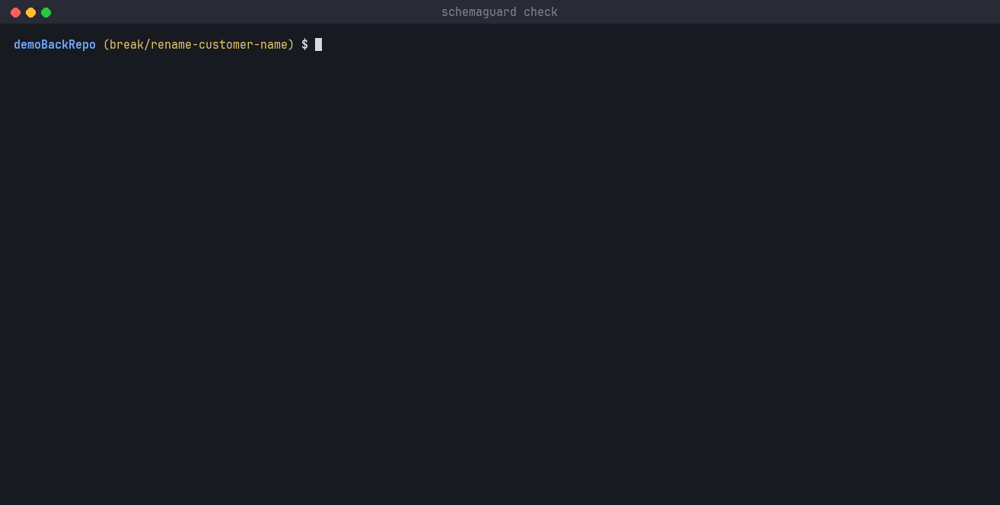
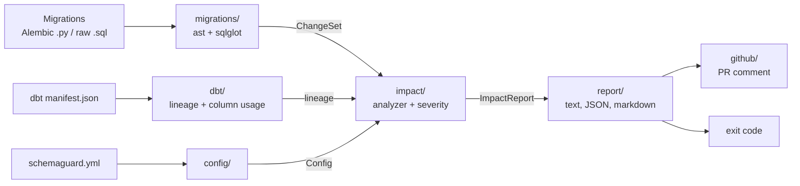

# SchemaGuard

SchemaGuard catches database migrations that would break your data team's dbt models, in the backend pull request, before they are merged.

It reads the migrations changed in a PR (Alembic or raw SQL), maps the changed tables and columns to dbt sources through `manifest.json`, walks dbt lineage downstream, and posts the result as one PR comment. The check fails when a change is breaking.

## Demo



`schemaguard check` on the branches behind the two demo PRs, against `main`. The output is real; the GIF is rendered from it.

Two live PRs in the demo backend repo ([gazi04/demoBackRepo](https://github.com/gazi04/demoBackRepo)):

- [PR #1](https://github.com/gazi04/demoBackRepo/pull/1) renames `customers.name` to `full_name`. dbt's `stg_customers` reads `name`, so the check fails.
- [PR #2](https://github.com/gazi04/demoBackRepo/pull/2) adds a nullable `customers.surname` that nothing reads, so the check passes.

The comment on PR #1:

> ## SchemaGuard
>
> **worst: breaking · 1 breaking, 0 risky, 0 safe · 0 unmapped · 0 not analyzed**
>
> | Severity | Change | Location | Source | Affected models | Tests | Exposures |
> | --- | --- | --- | --- | --- | --- | --- |
> | 🔴 breaking | rename_column customers.name -> full_name | alembic/versions/4f2f54d90f25_rename_customers_name_to_full_name.py:24 | ecom.raw_customers | stg_customers (hop 1), customers (hop 2) | 7 | - |

Each new push to the PR updates the same comment instead of adding another one.

## How it works



1. **Parse migrations.** Alembic files are read with Python's `ast` (only `upgrade()`); raw SQL and `op.execute("...")` strings go through sqlglot. Both give the same list of changes. Anything the parsers don't understand is listed as "not analyzed", never skipped silently.
2. **Map to dbt.** `schemaguard.yml` says which backend table is which dbt source.
3. **Walk lineage.** Models that read the source directly are checked column by column, by parsing their `compiled_code`. Everything further downstream is followed table by table through `child_map`. `SELECT *` counts as reading every column and is marked uncertain.
4. **Rate each change.**

| Severity | When |
| --- | --- |
| 🔴 **breaking** | A column that a model or source test reads is dropped or renamed; a table behind a dbt source is dropped or renamed |
| 🟡 **risky** | A column in use changes type or becomes nullable |
| 🟢 **safe** | Nothing downstream reads the column; a column becomes NOT NULL; a column is added |

A drop and an add on the same table in one migration are flagged as a **possible rename**.

## Setup

You need a backend repo with Alembic or raw SQL migrations, and a dbt project whose sources point at that database.

### 1. Commit a compiled dbt manifest

In the dbt project, run `dbt compile` (or `dbt build`) and copy `target/manifest.json` into the backend repo, e.g. as `dbt/manifest.json`. `dbt parse` is not enough: it leaves `compiled_code` empty, and every first-hop model then falls back to uncertain table-level matching.

The manifest is a snapshot. Refresh it when the data team changes models.

### 2. Add `schemaguard.yml` to the backend repo root

```yaml
manifest: dbt/manifest.json        # default: target/manifest.json
migrations: alembic/versions       # default: alembic/versions
sources:                           # required: backend table -> <source>.<table> in dbt
  customers: ecom.raw_customers
  orders: ecom.raw_orders
ignore:                            # tables to skip (default: none)
  - alembic_version
fail_on: breaking                  # breaking | risky | never (default: breaking)
```

Paths are relative to the config file. Keys are bare table names (`customers`, not `public.customers`). Changes to tables that are neither in `sources` nor in `ignore` are listed as unmapped.

### 3. Add the workflow

`.github/workflows/schemaguard.yml`:

```yaml
name: SchemaGuard

on:
  pull_request:

concurrency:
  group: schemaguard-${{ github.event.pull_request.number }}
  cancel-in-progress: true

jobs:
  schemaguard:
    runs-on: ubuntu-latest
    timeout-minutes: 5
    permissions:
      contents: read
      pull-requests: write   # to post the comment
    steps:
      - uses: actions/checkout@v5
        with:
          fetch-depth: 2     # SchemaGuard diffs the PR's merge commit against HEAD^1
      - uses: gazi04/schemaGuard@main
```

Only the migrations changed in the PR are checked, so a breaking migration merged earlier doesn't fail every later PR. Keep the default checkout (no custom `ref:`): it gives the merge commit, whose first parent is the base branch.

Action inputs, all optional:

| Input | Default | Meaning |
| --- | --- | --- |
| `config` | `schemaguard.yml` | Path to the config, relative to `working-directory` |
| `fail-on` | the config's `fail_on` | `breaking`, `risky` or `never` |
| `github-token` | `${{ github.token }}` | Token for the comment; needs `pull-requests: write` |
| `working-directory` | `.` | Folder of the backend project |

## CLI

The Action wraps the same CLI, which also runs locally:

```bash
uvx --from git+https://github.com/gazi04/schemaGuard schemaguard check --base main
```

| Command | What it does |
| --- | --- |
| `schemaguard check [FILES]...` | Checks the given migrations, or with `--base REF` the ones changed since `REF`, or every migration in the folder |
| `schemaguard parse <file>` | Prints the changes found in one migration |
| `schemaguard lineage <source>.<table> --manifest <path>` | Prints the models downstream of a dbt source and the columns first-hop models read |

`check` options: `--config/-c` (default `schemaguard.yml`), `--format/-f text|json|markdown`, `--fail-on breaking|risky|never`, `--base REF`, `--pr N` (posts the comment; reads `GITHUB_TOKEN` and `GITHUB_REPOSITORY`).

Exit codes: `0` below the `fail_on` threshold, `1` at or above it, `2` for a usage problem (bad config, missing manifest, unknown file type, a mapped source missing from the manifest). Unmapped and not-analyzed entries never fail the run.

## Known limitations

SchemaGuard is an MVP: Alembic and raw SQL, Postgres, GitHub. The main limits:

- **Manifest:** must be committed (or otherwise present) and compiled; the Action does not run dbt, so a stale manifest gives stale results.
- **Lineage:** columns are matched only at the first hop; deeper models are matched by table. `SELECT *` and SQL that can't be parsed fall back to table level, marked uncertain. A column with the same name in a joined table counts as used.
- **Migrations:** only `upgrade()` is read. Table and column names must be string literals; `batch_alter_table`, keyword-only arguments, `sa.text(...)`, f-strings and variables become "not analyzed". Index, constraint and enum changes are not checked, and harmless statements (`CREATE INDEX`, `BEGIN`) show up as not analyzed.
- **Not analyzed never fails:** a PR whose only change can't be read passes, with the entry listed in the comment.
- **Names:** schema prefixes are dropped (`public.orders` and `staging.orders` are both `orders`); the table-to-source mapping is written by hand; renames are not followed across migrations in the same PR.
- **GitHub:** PRs from forks get a read-only token, so no comment is posted (the check still fails on severity). The workflow above uses `@main`, not a pinned version.
- **Replication:** tools like Fivetran or Airbyte may soften renames and drops; SchemaGuard assumes the change reaches the warehouse as written.

The full list is in [`docs/architecture.md`](docs/architecture.md#known-limitations-mvp).

## Development

```bash
uv sync
uv run pytest          # tests
uv run pyright         # type check (strict)
uv run ruff check .    # lint
uv run pre-commit run --all-files
```

Design and decisions: [`docs/architecture.md`](docs/architecture.md). Plan and progress: [`docs/roadmap.md`](docs/roadmap.md).
